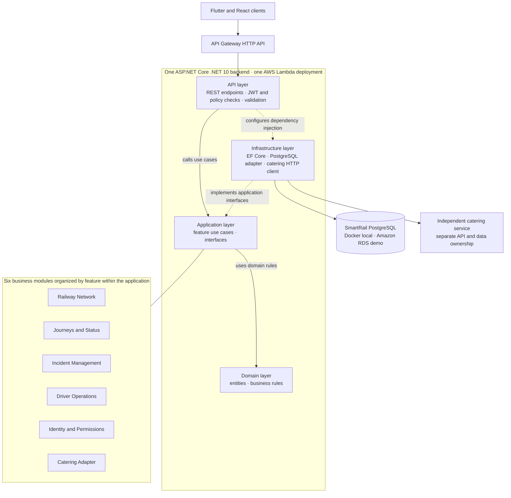
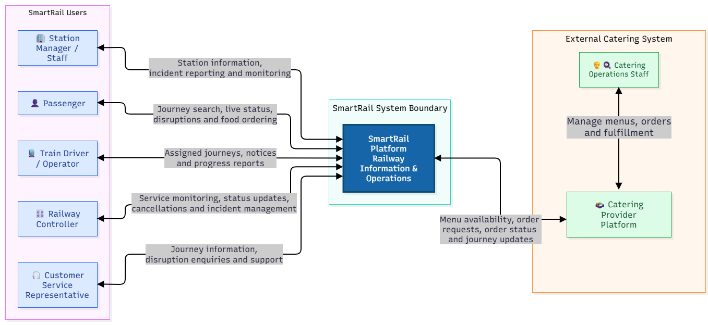
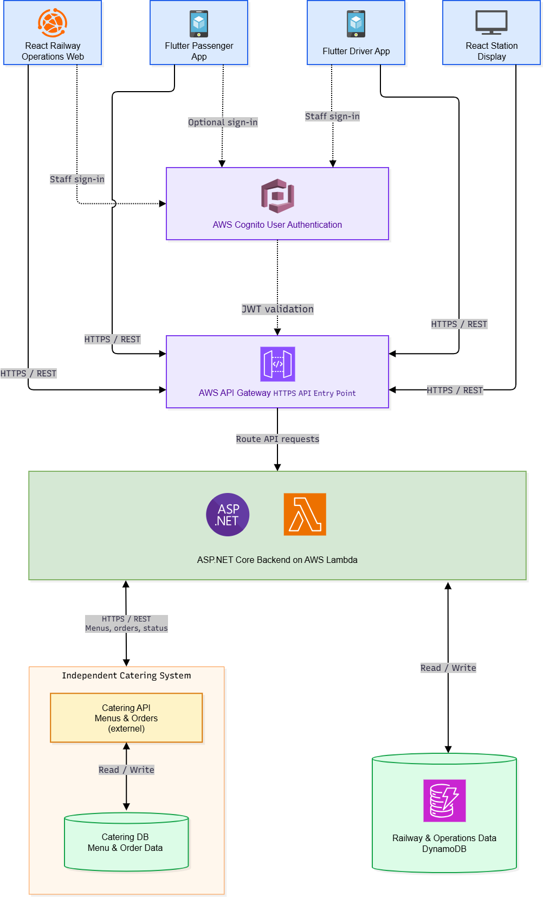
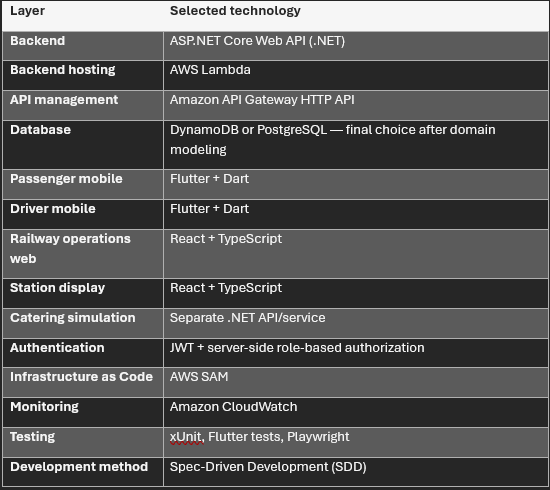
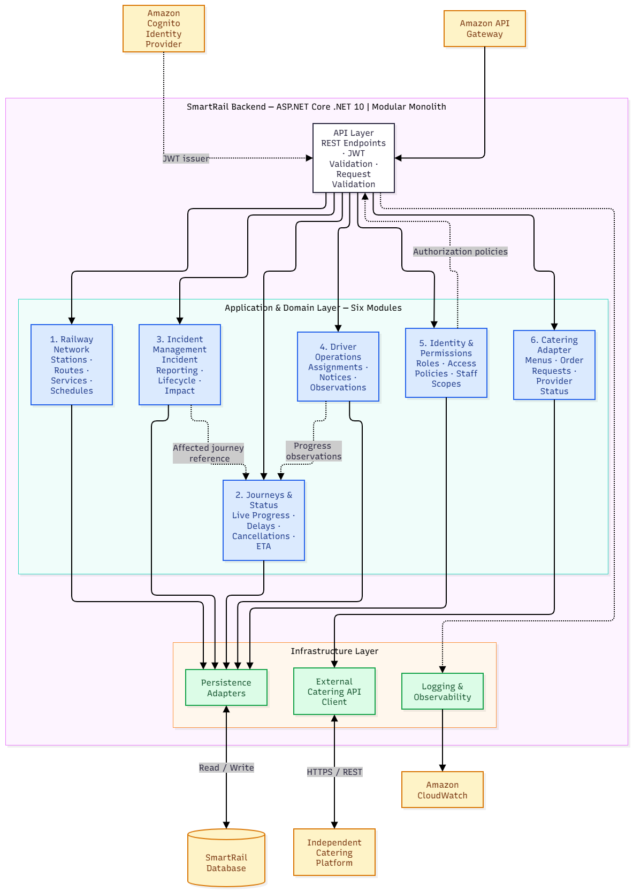
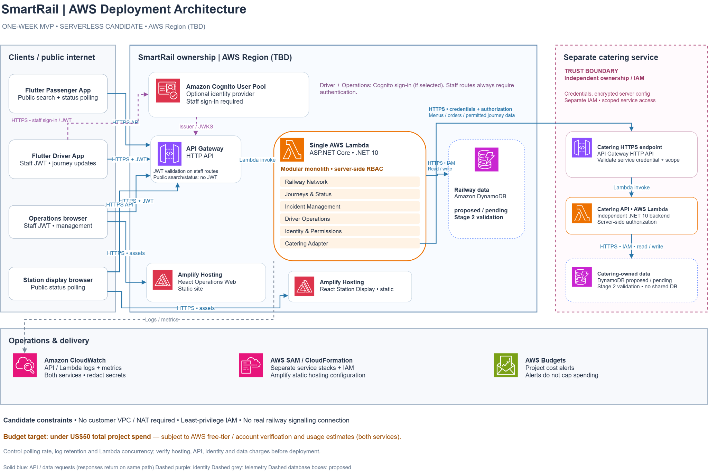
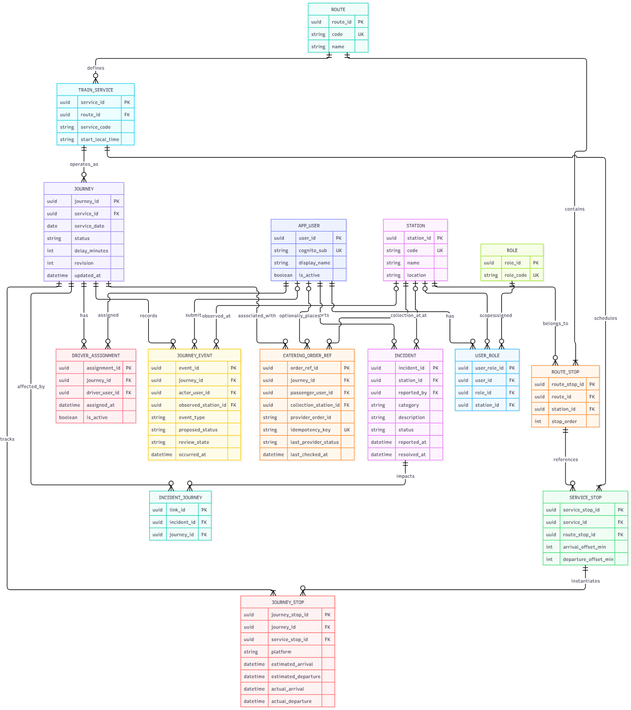

# SmartRail — SDD implementation handoff

**Baseline:** 16 October 2026 · **Status:** ready to begin feature specifications; unresolved rules below must be settled before implementing the affected feature. This is a design handoff, not evidence of working software.

## 1. Objective and source authority

Build a coherent public railway passenger and operations demonstrator: passengers find trains and trustworthy disruption information; authorized railway staff coordinate journeys and incidents; drivers report progress; station displays show consistent departures; a separate catering service supplies menu and order state.

The [approved requirements workbook](evidence/requirements.xlsx), `FINAL UNIFIED REQUIREMENTS` columns A:R, owns scope and accepted wording. The user's later PostgreSQL and Cognito decisions in the handoff request control technology choices. The newly supplied **ADR-007, SmartRail Backend** selects Modular Monolith + Pragmatic Clean Architecture with feature-based organization. The [RBAC/API PDF](evidence/rbac-api-contracts.pdf) owns the transcribed permission and endpoint inventories. The six previously supplied diagram images remain original, including outdated labels; the new Mermaid diagram below explains ADR-007 separately. Implementation recommendations in this handoff are identified as SDD work, not additional approved requirements.

**Architecture decision supersedes older diagram labels:** use **PostgreSQL in Docker locally → Amazon RDS PostgreSQL for the demo**, with EF Core. DynamoDB and database-TBD labels in the container, technology-stack and AWS images are superseded. The AWS image's “No customer VPC / NAT required” statement is also superseded: design Lambda-to-RDS VPC networking, subnets and security groups; private database access must be restricted to the application. Public catering/API egress may require NAT or another explicitly designed route. RDS, NAT, hosting, logs and other services mean **total spending under US$50 is a target, not guaranteed**. Cognito is selected even where the deployment image calls it optional. No image has been edited to conceal these conflicts.

## 2. MVP boundaries and delivery evidence

| Tier | Verified count | Release treatment |
|---|---:|---|
| Must Have | 53 | Committed seven-day MVP |
| Should Have | 42 | Stretch after five critical flows work reliably |
| Could Have | 16 | Deferred |
| Won’t Have — this release | 6 | Excluded |
| Total | 117 | Unique SR-001 through SR-117 |

See the [compact requirement inventory](requirements-inventory.md) for all 53 exact Must statements, their source acceptance checks and delivery constraints, plus the other 64 requirements. These are shared capabilities, not 53 screens. Source rows are retained so every specification can cite evidence.

Deliver Flutter passenger and driver apps, React/TypeScript operations web and **one** station display prototype, a common backend, and an independent catering simulation. Use seeded railway data and authorized manual updates; reliable external telemetry is not a prerequisite. In-app change alerts satisfy the scoped notification proof; native push and an interactive kiosk are not required. Unknown ETA/location must stay unknown or explicitly last known.

Do not add ticket sales, refunds/settlement, train braking/signalling/doors or movement authority, certified DMI functions, maintenance ERP, individual assistance tracking, predictive optimization or advanced reservations. The exact deferred/excluded register is in the inventory and workbook; broader discoveries are not automatically MVP commitments. Assessment obligations remain separate: personas, flows, wireframes, architecture, threat model, QA evidence, five automated E2E tests, AI usage trail and stakeholder demo.

### Five required automated E2E flows

These scenarios and anchors come from `7-DAY PRIORITY PLAN`; the driver authorization clarification below reconciles them with the later RBAC matrix.

| Flow | Required chain and observable proof | SR anchors |
|---|---|---|
| 1. Passenger lookup | Search origin/destination/date → ordered route/service details → current journey status and ETA/unavailable state; include no results | 002, 003, 004, 013, 019, 021 |
| 2. Disruption fan-out | Controller publishes disruption/cancellation/platform change → passenger in-app alert and station departures refresh from the same authoritative revision | 040, 046, 048, 022, 025, 054, 056, 058 |
| 3. Driver reporting | Driver login → own assignment → progress observation → controller review and authorized publication → refreshed live views; driver cannot publish official status directly | 064, 065, 066, 069, 031 |
| 4. Catering | Eligible journey/menu/collection point → authenticated order to separate simulation → provider reference/status; retry same key produces one order | 074, 075, 077, 078, 079, 080, 081 |
| 5. Incident lifecycle | Authorized operator records incident → valid lifecycle update → links affected journey(s) → disruption visible to passengers | 038, 041, 042, 044, 022 |

## 3. Architecture and original diagrams

Selected design : **ASP.NET Core .NET 10 modular monolith with pragmatic Clean Architecture and feature-based organization**, deployed as one SmartRail AWS Lambda behind **API Gateway HTTP API**. Cognito issues JWTs; server policies enforce role and resource scope. Use PostgreSQL/EF Core, AWS SAM for infrastructure and CloudWatch for structured logs/metrics. Flutter/Dart supplies mobile clients; React/TypeScript supplies operations and station display. The independent catering .NET service owns its own process/API and storage boundary. Static React hosting is depicted as Amplify; configure hosting and cost explicitly in the deployment spec.

### how the backend works



**Dependency rule:** domain code has no dependency on ASP.NET Core, EF Core, AWS or the catering provider. Application use cases depend on domain rules and define the interfaces they need. Infrastructure implements those interfaces; the API invokes use cases and composes dependencies. The six modules are code and ownership boundaries **inside the same backend**, not six deployments or databases. Cross-module changes pass through explicit application contracts instead of editing another module's state directly.

**Pragmatic .NET solution layout:**

```text
SmartRail.sln
├── SmartRail.Api              # endpoints, JWT/policies, middleware, composition
├── SmartRail.Application      # six feature folders, use cases, interfaces
├── SmartRail.Domain           # entities, value objects, rules; feature folders as needed
├── SmartRail.Infrastructure   # EF Core/PostgreSQL, provider client, adapters
└── SmartRail.Tests            # unit, integration and policy tests
```

Keep feature folders aligned across layers where useful. Avoid separate projects per business module, generic repositories for every table, mandatory MediatR/CQRS and an event bus for this one-week MVP. An in-process application call or explicit domain event is enough when one module needs to notify another; persistence and publication still require consistent transactions and audit behavior. The independent catering simulation remains a separate service because its ownership boundary is external to SmartRail.

### System context — C4 L1



The context includes Customer Service Representative and catering staff actors. The MVP permission PDF does not define a CSR role or a provider administration UI. Do not grant additional write permissions from the actor diagram; use permitted public information until a later scope decision.

### Container architecture



**Superseded label:** railway/operations DynamoDB is replaced by PostgreSQL → RDS; the independent catering storage remains separately owned.

### Technology stack reference



**Superseded label:** database selection is complete: PostgreSQL with EF Core. Backend target is .NET 10 and Cognito is selected.

### Backend components — C4 L3



### AWS deployment reference



**Superseded labels:** railway DynamoDB, optional Cognito and no-VPC/NAT assumptions are not the current implementation baseline. The catering-owned DynamoDB box is a historical proposal, not authority to share SmartRail's database or a confirmed provider storage choice. Confirm simulation storage independently.

### Domain and logical database reference



This supplied ERD is the available domain/data reference; no separate domain-model image was supplied. Treat it as the starting logical model, not a complete migration script.

## 4. Six backend module boundaries

These modules follow ADR-007's feature organization within the application and, where useful, domain and infrastructure layers. The C4 Level 3 image below the architecture decision remains the original component evidence; the Mermaid diagram explains the newly selected layer and deployment structure.

| Module | Owns | Boundary / collaboration |
|---|---|---|
| Railway Network | Stations, routes/ordered stops, train services and reusable schedules | Publishes reference data; never owns live journey state |
| Journeys & Status | Dated journey instances/stops, official progress, delay, cancellation, ETA, revision and published updates | Only authorized publication changes truth; operations overview is a composed read model, not a seventh domain module |
| Incident Management | Incident record, simple lifecycle and journey-impact links | Links one incident to multiple journeys; uses Journeys publication rules for passenger-visible effects |
| Driver Operations | Assignments, own-driver queries and authored progress observations | Observations are evidence for Control; no direct official cancellation or movement control |
| Identity & Permissions | Cognito-subject mapping, application roles, resource/station scopes and access policies | Cognito authenticates; backend checks active user, role and target resource on every protected operation |
| Catering Adapter | Journey-based discovery, provider requests, local order reference, retry/idempotency and status refresh | Provider owns menu, acceptance, fulfilment and commercial state; no shared provider database |

Recommended implementation discipline: module-owned writes and explicit application interfaces; share identifiers/contracts rather than bypassing another module's rules. Infrastructure supplies EF Core persistence, external HTTP client and logging. Health is platform infrastructure.

### Data ownership and model gaps

ERD entities: `STATION`, `ROUTE`, `ROUTE_STOP`, `TRAIN_SERVICE`, `SERVICE_STOP`, `JOURNEY`, `JOURNEY_STOP`, `JOURNEY_EVENT`, `DRIVER_ASSIGNMENT`, `INCIDENT`, `INCIDENT_JOURNEY`, `APP_USER`, `ROLE`, `USER_ROLE`, `CATERING_ORDER_REF`.

Keep reusable service schedules distinct from dated journeys (SR-007). Preserve route order and distinguish planned, estimated and actual times. Cognito is the credential authority; application mappings/scopes belong to SmartRail. SmartRail is the official railway state authority; a driver observation is not an approved publication. Catering provider responses are the order-state authority; local references/cache never imply acceptance or payment success.

Before migrations, specify foreign keys, uniqueness, indexes, nullability, UTC instants versus Sri Lankan service dates/local schedule times, concurrency and retention. Confirm uniqueness of service/date instances and ordered stops rather than assuming one departure per day. `INCIDENT_JOURNEY` supports many-to-many impact. `JOURNEY_EVENT` includes proposed status/review state, but review transitions and publication linkage are incomplete. `JOURNEY_STOP` lacks explicit revision/history and original planned values: decide how platform/time edits preserve audit history and consistent revision-based reads. Do not alter the reference image; record migration decisions in the spec.

### Catering trust boundary

Run the simulation as a separate .NET service with independent credentials and storage ownership. SmartRail transmits only needed journey, collection and order context over authenticated HTTPS in deployment. Define provider discovery/create/status contracts in OpenAPI; these are absent from the 21 SmartRail routes. Validate provider responses before updating local state. Keep provider reference, last checked time, unknown/pending state and passenger ownership.

For SR-081, design durable idempotency across both services: scope keys to caller/operation, bind to a request fingerprint, persist the result/reference, reject conflicting reuse and define retention and concurrent-retry behavior. After a lost response, query/retry using the same key; never announce success until provider confirmation. Bound timeouts and retries; catering failure must leave core railway features available (SR-088/113). Webhooks are optional, not a delivery dependency. If added later, define authentication, replay protection and reconciliation.

**Commercial assumption:** provider payment responsibility/merchant-of-record is not contractually confirmed (SR-087; AD-002 remains an assumption). Do not build a clearinghouse, automatic refunds or food-waste liability allocation. Simulation payment labels must not be represented as actual payment proof.

## 5. RBAC baseline

Transcribed from PDF page 1. R = read, C = create, U = update, — = no grant. “Own” and “scoped” are mandatory server checks. Public and authenticated passenger are distinguished per row.

| Action | Public / Passenger | Driver | Station Staff | Controller |
|---|---|---|---|---|
| Search trains, stations and schedules | R | R | R | R |
| View published journey status | R | R | R | R |
| View station departures | R | R | R | R |
| View operations dashboard | — | — | R (scoped) | R |
| View driver assignments | — | R (own) | — | R |
| Submit driver progress observation | — | C (own) | — | — |
| Review driver observations | — | — | — | R |
| Publish official journey status | — | — | — | U |
| Change platform/operational timing | — | — | — | U |
| Confirm journey cancellation | — | — | — | U |
| Create incident | — | — | C (scoped) | C |
| View incidents | — | — | R (scoped) | R |
| Update incident lifecycle | — | — | U (scoped) | U |
| Discover catering options | R | R | R | R |
| Create catering order | C (authenticated passenger only) | — | — | — |
| View catering order | R (own) | — | — | — |

Validate JWT signature, issuer, intended audience and expiry; server authorization must not trust client-supplied roles, user IDs or station scope. Public routes expose a safe published projection. Protected routes reject absent/invalid tokens; authenticated callers without permission receive denial. Resolve multi-role semantics, assignment validity and station-to-journey scope in Identity specs. `/api/me` and health disclosure require explicit policies because they are not separate rows in this matrix. Health must not expose database credentials or private diagnostics.

## 6. Essential API inventory and remaining contract work

The following **21 method/path entries** are transcribed from PDF page 2. Access mapping is derived from page 1, not additional PDF schema content. Query placeholders are retained as written.

| # | PDF module | Endpoint | Derived access |
|---:|---|---|---|
| 1 | Railway Network | `GET /api/stations` | Public read |
| 2 | Railway Network | `GET /api/routes/{id}/stops` | Public read |
| 3 | Railway Network | `GET /api/services?origin=&destination=&date=` | Public read |
| 4 | Railway Network | `GET /api/services/{id}` | Public read |
| 5 | Journeys & Status | `GET /api/journeys/{id}` | Public published projection |
| 6 | Journeys & Status | `GET /api/journeys/{id}/updates` | Public published projection |
| 7 | Journeys & Status | `GET /api/stations/{id}/departures` | Public read |
| 8 | Journeys & Status | `PATCH /api/operations/journeys/{id}/status` | Controller |
| 9 | Journeys & Status | `PATCH /api/operations/journeys/{id}/stops/{stopId}` | Controller |
| 10 | Operations | `GET /api/operations/overview` | Controller / scoped station staff |
| 11 | Driver Operations | `GET /api/driver/assignments` | Own driver / controller; selector policy TBD |
| 12 | Driver Operations | `POST /api/driver/journeys/{id}/observations` | Assigned driver |
| 13 | Driver Operations | `GET /api/operations/journeys/{id}/observations` | Controller |
| 14 | Incident Management | `GET /api/incidents` | Controller / scoped station staff |
| 15 | Incident Management | `POST /api/incidents` | Controller / scoped station staff |
| 16 | Incident Management | `PATCH /api/incidents/{id}` | Controller / scoped station staff |
| 17 | Identity & Permissions | `GET /api/me` | Authenticated; exact projection TBD |
| 18 | Catering Adapter | `GET /api/catering/options?journeyId=` | Public discovery |
| 19 | Catering Adapter | `POST /api/catering/orders` | Authenticated passenger |
| 20 | Catering Adapter | `GET /api/catering/orders/{id}` | Owning passenger |
| 21 | Platform Monitoring | `GET /health` | Safe health policy TBD |

**Coverage conclusion:** the matrix and inventory support the core flow shape, but do not establish full implementation coverage of all 53 Musts. Cross-cutting security, resilience, accessibility, audit and deployment requirements require tests and implementation evidence beyond endpoint presence.

| Coverage area | Evidence / gap to close in SDD |
|---|---|
| Network/search — SR-002/003/004/013 | Reads exist; SR-002 source acceptance includes record creation but no management write routes. Choose documented seed/migration provisioning or specify authorized administration, without claiming PDF coverage of writes |
| Official updates/fan-out — SR-010/022/025/031/040/046/048/054/056/058 | Define status/stop PATCH payloads, cancellation policy, revision, polling/refresh and in-app alert consumption |
| Driver chain — SR-064–066/069 | PDF grants controller review **read**, not a review mutation. Define how status publication references/reviews an observation using existing PATCH, or explicitly propose another operation; do not allow driver auto-publication |
| Incident impact — SR-041/042/044 | Specify incident-to-many-journey links and permitted lifecycle updates in existing create/PATCH schemas |
| Catering — SR-074–081/087/088/094 | SmartRail routes exist; separate provider schemas, credentials, ownership, idempotency and failure semantics still required |
| Identity — SR-089/090/091/093 | Define claims-to-role/resource mappings, secure token/session handling and denial tests; `/api/me` alone proves none of these |
| Quality and operations — SR-035/095/100/102/109/113–115/117 | Verify with UI, API, fault, log and clean-start tests; no extra route is inherently required |

For each endpoint, create OpenAPI request/response schemas and examples, field constraints, identifiers, date/time formats, nullable ETA/freshness, success/error codes, authentication/policy, pagination/filtering where needed, concurrency/conflict behavior and structured safe errors. Specify idempotency headers and retry semantics for ordering. Document how published updates exclude internal observations and private incident content. Do not invent latency, polling, stale-data, retention or availability targets as approved facts; agree measurable values in the relevant spec.

## 7. Lifecycle decisions to make inside feature specs

| Aggregate | Existing source intent | Decisions required before implementation |
|---|---|---|
| Journey | Scheduled/running/delayed/interrupted/cancelled/completed examples (SR-019); authorized updates incl. termination (SR-040) | Exact enum, termination semantics, permitted transition graph, controller powers, stop/time validation, revision conflicts, terminal-state corrections and audit |
| Driver observation | Authored report visible to Control (SR-069), ERD proposed status/review state | Reporting vocabulary, own-assignment checks, review/publication linkage, rejected/duplicate reports, no direct official update |
| Incident | Reported → operational handling → resolved/closed (SR-042) | Exact states/actors, required fields, reopening, multi-journey links and impact removal; closing must not silently reverse official cancellation |
| Catering order | Provider-authoritative state, distinct pending/unknown (SR-079/088) | Provider vocabulary/mapping, uncertain-result reconciliation, retry key lifetime and permitted client actions; no fabricated payment/fulfilment |

These are specification questions, not a new approved state machine. Capture actor, preconditions, transition, persisted evidence, publication and failure behavior together.

## 8. SDD execution order and working contract

Recommended feature slices (quality/security work travels with each slice):

1. **Foundation and identity:** solution boundaries, Docker PostgreSQL, EF Core schema/seed, Cognito validation, policies and health; SR-001–004/007/089–091/093/100/115/117 as applicable.
2. **Passenger lookup and current journey:** ordered stops, service-to-journey lookup, ETA/freshness and error states; SR-013/019/021/035/102/109/114; automate flow 1.
3. **Controller publication and station fan-out:** status/stop updates, cancellation authorization, revisions, alert/refresh and audit; SR-010/022/025/031/034/038/040/046/048/054/056/058/059/061/095; automate flow 2.
4. **Incident coordination:** SR-041/042/044 plus scoped access and shared publication; automate flow 5.
5. **Driver reporting:** SR-064/065/066/069/072 with review/publication linkage; automate flow 3.
6. **Independent catering integration:** SR-074/075/077–081/087/088/094/113; automate flow 4.
7. **Release hardening and demo:** exercise all 53 Must acceptance checks, cross-client offline/error behavior, security evidence and clean deployment.

For each `specs/<feature>/` directory:

- `spec.md`: exact linked SR IDs and workbook rows, user flow, source acceptance wording, refined agreed scenarios, lifecycle, permissions/resource scope, failure cases, assumptions and non-goals. Link back to this handoff and requirement inventory.
- `plan.md`: module/data ownership, migrations, API/OpenAPI changes, UI/state behavior, integration/auth, infrastructure, observability and test approach. Record decisions resolving diagram conflicts.
- `tasks.md`: executable tasks linked to SR IDs and specific scenarios; include migrations/seed, backend, clients, tests, evidence and documentation. Link each task to its spec/plan section.

Maintain a traceability table `SR ID → spec section → task → implementation/API or UI → test/evidence → result`. Every Must needs an owner and evidence, including negative boundaries and nonfunctional requirements; the endpoint count is not a completion metric. Do not promote Should/Could scope implicitly.

## 9. Local setup and deployment outline

This package contains design evidence, not application code; the following is the repository setup to implement and document during SDD.

1. Pin .NET 10 SDK, compatible EF Core/Npgsql packages, Node/React tooling, Flutter SDK, Docker and AWS SAM tooling in the app repository. Define environment variable names and safe example configuration; keep secrets outside version control.
2. Add Docker Compose for a pinned PostgreSQL image, named volume, health check and development-only credentials. Keep catering storage/process independently configured. Document ports and startup/shutdown commands.
3. Restore/build backend and clients; apply reviewed EF Core migrations; run deterministic seed setup for stations, ordered routes, services, dated journeys, assignments, role scopes and incidents. Make rerunning seeds safe and give each E2E test isolated data.
4. Start backend, catering simulation, React apps and Flutter targets with documented base URLs. Configure local Cognito test users/clients and issuer/audience; any local fake authentication must be explicit and impossible to deploy accidentally.
5. Run .NET unit/integration tests against PostgreSQL (including constraints/concurrency), Flutter tests and React/Playwright tests, then five E2E flows. Document `dotnet test`, migration and actual repository start commands once projects exist.

Deploy shortly before the demo using reviewed SAM/CloudFormation stacks. Select AWS region, account, Lambda .NET 10 packaging/runtime compatibility, VPC/subnets, RDS sizing/storage/backup, database credentials/TLS and security groups. Restrict database access and use bounded connection pools/Lambda concurrency; evaluate connection management/proxy only against measured need and cost. Plan internet egress for public catering and required identity endpoints; putting Lambda in a public subnet alone is not an internet-egress design.

Deploy independent catering and SmartRail with separate permissions and configuration. Build React static assets and point all clients at the intended HTTPS API. Apply migrations as a controlled deployment step, not on every Lambda invocation. Set log retention/redaction, correlation IDs, error metrics and budget alerts; alerts do not cap spend. Estimate RDS/NAT and other charges before provisioning and define cleanup of stacks, database snapshots, logs and hosting after evidence capture. Do not assume free-tier eligibility.

**Deployment smoke checks:** safe health response; database/seed lookup; valid sign-in and expired-token denial; staff scope enforcement; controller change reaches passenger/display; assigned driver report is reviewable; incident lifecycle persists; separate catering create/status and same-key retry; provider outage leaves train search available. Verify configuration and logs expose no secrets. Record deployed version and evidence, then exercise a documented clean restart.

## 10. Quality, risks and definition of done

Use xUnit for domain/policy/integration tests, Flutter tests for mobile behavior and Playwright for web journeys. Cross-surface E2E orchestration must exercise real HTTP/persistence and the separate catering simulation; mocked component tests alone do not satisfy the five flows. For mobile, include device/emulator automation or a documented integrated Flutter test harness.

Security evidence must cover missing/forged/expired JWTs, wrong audience/issuer, driver-other-assignment access, station-other-resource access, non-controller cancellation, another passenger's order, malformed provider payloads, duplicate/concurrent ordering, safe message rendering/XSS, secret-free logs/errors and secure token storage/expiry. Verify both denied response and absence of unauthorized state changes. Check status meaning without color, visible last-updated/offline labels, no-result/loading/error/retry states, missing ETA and bounded catering failures. These execute source criteria; numeric targets remain to be agreed.

| Open decision / risk | Required resolution owner / point |
|---|---|
| Journey/incident/order transition details and review/publication gap | Feature spec author with railway policy validation before affected feature |
| Station scope, multi-role users, controller assignment selector and `/api/me` policy | Identity spec before protected routes |
| Detailed OpenAPI and separate provider contract absent | Feature/API spec before parallel client/backend work |
| ERD audit/concurrency/planned-time gaps | Data plan before migrations |
| No dependable live feed | Use seeded/manual authorized data; expose missing/stale values |
| Merchant/payment/liability remains an assumption | Explicit demo boundary; external commercial agreement before real payment behavior |
| AWS region/runtime/networking, egress and RDS cost | Deployment plan before provisioning; under-$50 outcome not guaranteed |
| Poll intervals, freshness limits, retention and measurable targets unset | Agree in feature/deployment specs; do not claim source approval |
| Context diagram CSR role not in MVP matrix | No inferred staff powers; defer or explicitly scope read-only support |
| Seven-day capacity | Finish five flows/53 Must checks first; defer stretch scope |

**Definition of done:** all 53 Must IDs have implementation or explicit boundary evidence and passing source acceptance checks; five E2E flows run reliably; API contracts and lifecycle/security decisions are documented; denied actions do not change state; migrations and seeds are repeatable; clients show honest status/failure/freshness; catering remains independent and idempotent; deployed smoke tests pass; no secret leakage; clean-start instructions, traceability, threat/QA evidence and demo/AI usage records are available. Unresolved defects and deviations are visible and approved rather than silently treated as done.


The eight supplied attachments were recovered from the referenced chat's attachment records; the request's `/mnt/data/` paths are historical upload paths, not this Windows task's filesystem. Copies in this package are the source evidence used. The similarly named project workbook and pre-existing generated AWS diagram were not substituted for the uploaded originals.

| Source | Packaged reference | Use |
|---|---|---|
| SmartRail_MoSCoW_Approved_Requirements(1).xlsx | [Workbook](evidence/requirements.xlsx) | Unified rows 5–121; O:R priorities/approval/limits; priority plan and source audit sheets |
| RBAC & API Contracts.pdf | [Two-page PDF](evidence/rbac-api-contracts.pdf) | Page 1: 16 permission rows; page 2: 21 endpoint entries |
| SmartRail_Architecture.drawio.png | [Original container](assets/container.png) | Container boundaries; DynamoDB label superseded |
| railway context diagram.png | [Original context](assets/system-context.png) | Actors and external catering boundary |
| techstack.png | [Original stack](assets/technology-stack.png) | Stack reference; database-TBD label superseded |
| backend architecture.drawio.png | [Original components](assets/backend-components.png) | Six backend modules |
| SmartRail-AWS-Deployment-final.png | [Original deployment](assets/aws-deployment.png) | Deployment reference; database/auth/network conflicts noted |
| er diagarm.drawio(1).png | [Original ERD](assets/erd.png) | Logical entities/relationships; migration refinements required |

User's PostgreSQL selection is also recorded in the referenced “Simulate Stakeholder Discussions” chat (conversation `6ac47dc0-45c0-83ee-bc3b-d43fc51b65c1`); current request reconfirms it. See [source manifest](source-manifest.json) for original names, packaged paths, byte lengths and SHA-256 hashes. All six PNG files are copied byte-for-byte, preserving any embedded draw.io metadata. No diagram was redesigned, re-encoded or recreated.

ADR-007 is the user-supplied pasted text titled “SmartRail Backend” in this follow-up. Its copied Mermaid rendering styles were not used as architectural evidence; the decision text, dependency explanation and proposed solution layout informed the new diagram and FigJam card above. The new diagram is distinct from the six original PNGs.
